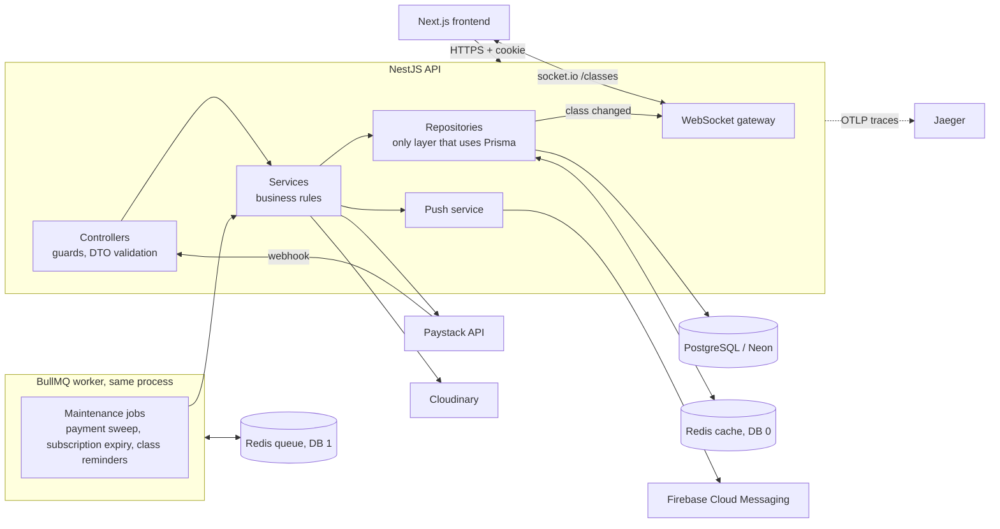
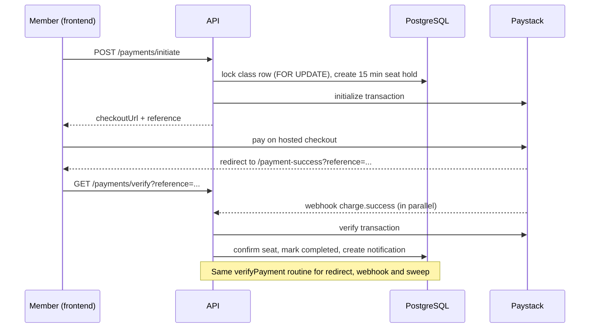

# Gym Ontime — Backend API

[](https://github.com/Dev-Jabbar/gym_ontime_nestjs_backend/actions/workflows/ci.yml)

REST and WebSocket API for **Gym Ontime**, a gym class booking platform. Members browse classes and pay with Paystack to get a confirmed seat; trainers manage their classes; admins manage everything.

This is a full rebuild of an earlier Express + MongoDB backend onto **NestJS, Prisma and PostgreSQL**, adding Redis caching, BullMQ background jobs, live seat counts over WebSockets, Firebase push notifications, OpenTelemetry tracing, Docker and CI. It keeps the original `/api/...` paths and response shapes, so the existing Next.js frontend works against it unchanged (the frontend has a switch to pick either backend).

> **Project status:** feature-complete and live-tested against a real Postgres (Neon) database. The Docker image builds and runs, and CI is green. The NestJS API is **not deployed to a public host yet**; see [Deployment](#deployment) and the [Roadmap](#roadmap).

## Table of contents

- [Features](#features)
- [Architecture](#architecture)
- [Tech stack](#tech-stack)
- [Data model](#data-model)
- [Key design decisions](#key-design-decisions)
- [Getting started](#getting-started)
- [Configuration](#configuration)
- [API reference](#api-reference)
- [Authentication and authorization](#authentication-and-authorization)
- [Payments flow](#payments-flow)
- [Background jobs](#background-jobs)
- [Caching](#caching)
- [Live seat counts (WebSocket)](#live-seat-counts-websocket)
- [Push notifications](#push-notifications)
- [Observability (OpenTelemetry tracing)](#observability-opentelemetry-tracing)
- [Testing and CI](#testing-and-ci)
- [Docker](#docker)
- [Deployment](#deployment)
- [Security](#security)
- [Troubleshooting](#troubleshooting)
- [Known limitations](#known-limitations)
- [Roadmap](#roadmap)

## Features

- Cookie-based JWT authentication with role-based access (`member`, `trainer`, `admin`)
- Class management with capacity, pricing, recurrence and trainer assignment
- **Race-free seat booking** with 15-minute holds
- Paystack payments: one-time and subscription (weekly, monthly, three months)
- Payment reconciliation from three paths: the user's redirect, the Paystack webhook (verified over the raw request body) and a background sweep
- Subscriptions expire automatically and free the member's seat
- **Live seat counts**: every open browser sees capacity change without refreshing (socket.io)
- **Push notifications** (Firebase Cloud Messaging) and class reminders an hour before a session
- In-app notifications (payment confirmed, payment needs review, class reminders)
- Signed Cloudinary uploads (the file never passes through this server)
- Redis caching that **fails open** when Redis is unavailable
- **OpenTelemetry tracing** to Jaeger (optional)
- `GET /api/health` for load balancers and orchestrators
- Hardening: helmet, login/register rate limiting, environment-aware cookie, CORS from env, env validation at boot
- Admin seed script, soft deletes and a repository layer that isolates all database access

## Architecture



**Layering rules**

- Controllers handle HTTP concerns only (guards, DTOs, status codes).
- Services hold business rules and decide which HTTP exception an outcome maps to.
- Repositories are the only code that imports `PrismaService`. They return data, `null` or a result code, and never throw HTTP exceptions.
- Modules call each other through **services**, never through another module's repository.

## Tech stack

| Concern    | Choice                                                                                |
| ---------- | ------------------------------------------------------------------------------------- |
| Framework  | NestJS 12                                                                             |
| Language   | TypeScript (ES modules)                                                               |
| Database   | PostgreSQL (Neon) via Prisma 7 with the `pg` driver adapter                           |
| Cache      | Redis via `ioredis`                                                                   |
| Queue      | BullMQ via `@nestjs/bullmq`                                                           |
| Real time  | socket.io via `@nestjs/websockets`                                                    |
| Push       | Firebase Admin SDK (FCM)                                                              |
| Tracing    | OpenTelemetry (OTLP) to Jaeger                                                        |
| Validation | `class-validator` / `class-transformer`, global `ValidationPipe({ whitelist: true })` |
| Auth       | JWT in an HTTP-only cookie, `bcrypt` (10 rounds)                                      |
| Security   | `helmet`, `@nestjs/throttler`                                                         |
| Payments   | Paystack (HTTP via `axios`)                                                           |
| Uploads    | Cloudinary (signed uploads)                                                           |
| Tests      | Vitest (28 unit tests)                                                                |
| CI         | GitHub Actions                                                                        |
| Containers | Docker, Docker Compose                                                                |
| Lint       | oxlint                                                                                |

## Data model

```mermaid
erDiagram
  User ||--o| MemberProfile : has
  User ||--o| TrainerProfile : has
  User ||--o| AdminProfile : has
  User ||--o{ Payment : makes
  User ||--o{ Notification : receives
  User ||--o{ DeviceToken : "push devices"
  TrainerProfile ||--o{ Class : teaches
  Class ||--o{ ClassMember : "confirmed seats"
  MemberProfile ||--o{ ClassMember : enrolls
  Class ||--o{ PendingSeat : "15 min holds"
  MemberProfile ||--o{ PendingSeat : holds
  Class ||--o{ Payment : "paid for"
  Payment ||--o| ClassSubscription : creates
  Class ||--o{ ClassSubscription : covers
```

Notes: `ClassMember` has a unique `(classId, memberProfileId)` constraint so a member can't be enrolled twice. `PendingSeat` is a time-limited hold. `ClassSubscription` stores `interval`, `startDate`, `endDate` and `status` (`active`, `expired`, `cancelled`). `DeviceToken` stores one row per browser or device registered for push. The schema lives in [`prisma/schema.prisma`](prisma/schema.prisma) and migrations in `prisma/migrations/`.

## Key design decisions

| Decision                                                        | Why                                                                                                                                               |
| --------------------------------------------------------------- | ------------------------------------------------------------------------------------------------------------------------------------------------- |
| **`SELECT ... FOR UPDATE` inside a transaction for seat holds** | Guarantees two people can't take the last seat, without a denormalized counter that could drift. Seat correctness never depends on the cache.     |
| **One `verifyPayment` routine for all payment outcomes**        | The redirect, the webhook and the sweep all call it, so every path reaches the same state. It is idempotent.                                      |
| **Webhook verified over the raw body with `timingSafeEqual`**   | Paystack signs the exact bytes it sends; re-serialising parsed JSON could reject a genuine event.                                                 |
| **Cache-aside in repositories, fails open**                     | Redis is an optimisation, not a dependency. If it is down, requests are served from Postgres and errors are logged at most once every 30 seconds. |
| **Push and tracing fail open too**                              | Missing Firebase credentials or an unreachable Jaeger can never break a request or a payment.                                                     |
| **Separate Redis DBs for cache and queue**                      | Queue data (DB 1, prefix `gymq`) can never collide with cache keys (DB 0).                                                                        |
| **BullMQ repeatable jobs instead of in-process cron**           | Retries with backoff, one worker at a time (`concurrency: 1`) and admin endpoints to trigger a run.                                               |
| **Live counts read from Postgres, never the cache**             | The WebSocket broadcast always carries the true seat count.                                                                                       |
| **Rate limiting only on login and register**                    | The brute-force targets are protected without throttling normal use.                                                                              |
| **Signed Cloudinary uploads**                                   | The API only signs a request. Image bytes go straight from the browser to Cloudinary.                                                             |
| **Response aliases (`_id`, `relatedClass`, ...)**               | Kept so the existing frontend, written for MongoDB ids, works unchanged.                                                                          |

## Getting started

### Prerequisites

- Node.js 22 and npm
- A PostgreSQL database (a free [Neon](https://neon.tech) project works)
- Redis (optional; without `REDIS_URL` the cache and queue are skipped)
- A Paystack account (test keys are fine); Cloudinary and Firebase are optional

### Install and run

```bash
git clone https://github.com/Dev-Jabbar/gym_ontime_nestjs_backend.git
cd gym_ontime_nestjs_backend

npm install --legacy-peer-deps

cp .env.example .env          # fill in your own values (never commit .env)
npx prisma migrate deploy     # apply migrations
npx prisma generate

# optional: Redis and Jaeger in Docker
docker compose up -d redis jaeger

npm run start:dev             # http://localhost:3001/api
curl http://localhost:3001/api/health
```

Create the first admin account:

```bash
npm run seed:admin
```

### Scripts

| Command              | Purpose                            |
| -------------------- | ---------------------------------- |
| `npm run start:dev`  | Run with file watching             |
| `npm run build`      | Compile to `dist/`                 |
| `npm run start:prod` | Run the compiled build             |
| `npm run seed:admin` | Create or ensure the admin account |
| `npm run lint`       | Lint with oxlint                   |
| `npm test`           | Unit tests (Vitest)                |

## Configuration

Copy [`.env.example`](.env.example) to `.env`. The app validates its settings at boot and exits with a clear message if a required one is missing.

| Variable                                                               | Required      | Default                         | Description                                                                      |
| ---------------------------------------------------------------------- | ------------- | ------------------------------- | -------------------------------------------------------------------------------- |
| `DATABASE_URL`                                                         | Yes           |                                 | PostgreSQL connection string (pooled Neon URL for the app)                       |
| `PAYSTACK_SECRET_KEY`                                                  | Yes           |                                 | Paystack secret key (`sk_test_...` in development)                               |
| `JWT_SECRET`                                                           | In production | dev fallback                    | 32+ characters when `NODE_ENV=production` (boot fails otherwise)                 |
| `FRONTEND_URL`                                                         | In production |                                 | Frontend origin; Paystack redirects to `${FRONTEND_URL}/payment-success`         |
| `NODE_ENV`                                                             | No            |                                 | `production` enables the cross-site cookie, stricter validation and proxy trust  |
| `PORT`                                                                 | No            | `3001`                          | HTTP port                                                                        |
| `CORS_ORIGINS`                                                         | No            | localhost and the Vercel origin | Comma-separated allowed origins. **When set it replaces the defaults.**          |
| `COOKIE_CROSS_SITE`                                                    | No            | auto                            | `true` / `false` overrides the cookie `SameSite`/`Secure` detection              |
| `TRUST_PROXY_HOPS`                                                     | No            | 1 in production, else 0         | Number of proxies in front of the app (needed for per-client rate limits)        |
| `THROTTLE_DISABLED`                                                    | No            |                                 | `true` switches login rate limiting off (testing only)                           |
| `CLOUDINARY_CLOUD_NAME`, `CLOUDINARY_API_KEY`, `CLOUDINARY_API_SECRET` | No            |                                 | Image uploads (warns if missing)                                                 |
| `REDIS_URL`                                                            | No            |                                 | Enables cache and queue. Use `rediss://` for TLS                                 |
| `QUEUE_REDIS_DB`                                                       | No            | `1`                             | Redis DB used by the queue                                                       |
| `MAINTENANCE_INTERVAL_MINUTES`                                         | No            | `15`                            | How often the payment sweep runs                                                 |
| `PAYMENT_STALE_MINUTES`                                                | No            | `30`                            | Age at which a pending payment is re-verified                                    |
| `SUBSCRIPTION_EXPIRY_INTERVAL_MINUTES`                                 | No            | `60`                            | How often subscription expiry runs                                               |
| `CLASS_REMINDER_INTERVAL_MINUTES`                                      | No            | `15`                            | How often class reminders run                                                    |
| `CLASS_REMINDER_WINDOW_MINUTES`                                        | No            | `60`                            | How far ahead a class is reminded                                                |
| `FIREBASE_PROJECT_ID`, `FIREBASE_CLIENT_EMAIL`, `FIREBASE_PRIVATE_KEY` | No            |                                 | Enable push. Push is disabled if any is missing                                  |
| `OTEL_ENABLED`                                                         | No            |                                 | `true` turns tracing on                                                          |
| `OTEL_SERVICE_NAME`                                                    | No            | `gym-ontime-backend`            | Service name shown in Jaeger                                                     |
| `OTEL_EXPORTER_OTLP_ENDPOINT`                                          | No            | `http://localhost:4318`         | OTLP HTTP endpoint                                                               |
| `ADMIN_EMAIL`, `ADMIN_NAME`, `ADMIN_AVATAR`, `ADMIN_PASSWORD`          | No            | see seed                        | Admin seed settings; `ADMIN_PASSWORD` is **required** when `NODE_ENV=production` |

## API reference

Base URL: `/api`. Authentication uses the session cookie set at login. Payments endpoints respond with `{ success, message, data }`.

**Access:** _Public_ = no login. _Auth_ = any logged-in user. Otherwise the role(s) allowed.

| Area                              | Method and path                                                                                          | Access                                   |
| --------------------------------- | -------------------------------------------------------------------------------------------------------- | ---------------------------------------- |
| **Health**                        | `GET /health` (database and Redis status: `ok`, `degraded`, or `error` with HTTP 503)                    | Public                                   |
| **Auth** (mounted under `/users`) | `POST /users/register`, `POST /users/login` (rate limited: 10 per minute per IP)                         | Public                                   |
|                                   | `GET /users/me`                                                                                          | Auth                                     |
|                                   | `POST /users/logout`                                                                                     | Public                                   |
| **Users**                         | `GET /users`                                                                                             | admin                                    |
|                                   | `GET /users/:id`, `PUT /users/:id`                                                                       | admin or the user themselves             |
|                                   | `DELETE /users/:id` (soft delete)                                                                        | admin                                    |
|                                   | `POST /users/:id/upgrade-to-trainer`                                                                     | admin                                    |
| **Classes**                       | `GET /classes`, `GET /classes/:id` (trainer phone hidden for anonymous callers)                          | Public                                   |
|                                   | `POST /classes`, `PUT /classes/:id`, `DELETE /classes/:id`                                               | admin                                    |
|                                   | `GET /classes/:id/members`                                                                               | trainer, admin                           |
|                                   | `GET /classes/by-member/:memberProfileId`                                                                | admin                                    |
|                                   | `POST` / `DELETE /classes/:id/members/:userId`                                                           | admin                                    |
|                                   | `PUT /classes/:id/trainer/:userId`                                                                       | admin                                    |
| **Members**                       | `POST /members/profile`, `GET` / `PUT` / `DELETE /members/me`                                            | member                                   |
|                                   | `GET /members`                                                                                           | admin                                    |
|                                   | `GET /members/:id`                                                                                       | admin, trainer, or the member themselves |
| **Trainers**                      | `POST /trainers/profile`, `GET` / `PUT` / `DELETE /trainers/me`                                          | trainer                                  |
|                                   | `GET /trainers/my-classes`                                                                               | trainer                                  |
|                                   | `GET /trainers`, `GET /trainers/:id` (date of birth visible to admin only)                               | Auth                                     |
| **Admin profile**                 | `GET /admins/me`, `PUT /admins/me`                                                                       | admin                                    |
| **Payments**                      | `POST /payments/initiate`, `GET /payments/verify`, `GET /payments/my-payments`                           | member                                   |
|                                   | `GET /payments`, `GET /payments/:id`, `GET /payments/class/:classId`                                     | admin                                    |
|                                   | `POST /payments/webhook`                                                                                 | Public (verified by HMAC signature)      |
| **Notifications**                 | `GET /notifications/my-notifications`, `PUT /notifications/:id/read`, `PUT /notifications/mark-all-read` | Auth                                     |
|                                   | `POST` / `DELETE /notifications/device-token` (register or remove a push device)                         | Auth                                     |
| **Uploads**                       | `POST /uploads/signature`                                                                                | Auth                                     |
| **Maintenance**                   | `POST /maintenance/run`, `/expire-subscriptions`, `/class-reminders` (queue that job now)                | admin                                    |

A Postman collection is used for manual testing. OpenAPI/Swagger documentation is on the [roadmap](#roadmap).

## Authentication and authorization

- Login sets an **HTTP-only** cookie containing a signed JWT (7 days). The browser cannot read it from JavaScript.
- The cookie is environment-aware: `SameSite=Lax` locally; with `NODE_ENV=production` it is `SameSite=None; Secure`, which a frontend on another domain (such as Vercel) needs, and requires https.
- `JwtAuthGuard` validates the cookie, `OptionalJwtAuthGuard` identifies a user without requiring one, and `RolesGuard` with `@Roles(...)` enforces roles.
- "Admin or the user themselves" rules are checked inside the controller, since a role list can't express them.
- Passwords are hashed with bcrypt (10 rounds). Login and register are rate limited.

## Payments flow



- A one-off class that has already started cannot be booked (`400`). Recurring classes stay bookable.
- If Paystack reports the charge didn't succeed, the payment is marked `failed` and the seat hold is released.
- If the member was charged but the seat is no longer available, the payment is flagged `needsReview` and the member is notified.
- The background sweep re-verifies payments that stayed `pending`, so a closed browser tab doesn't lose a booking.
- The webhook checks the `x-paystack-signature` header (HMAC-SHA512 over the raw body, constant-time comparison) and returns `401` on a missing or wrong signature.

## Background jobs

Three BullMQ repeatable jobs run on the `maintenance` queue, one at a time, each with 3 attempts and exponential backoff.

### Payment sweep (every 15 minutes)

Re-verifies pending payments older than `PAYMENT_STALE_MINUTES`, force-expires payments still unresolved after 24 hours and deletes expired seat holds. Logs `{ checked, resolved, unresolved, hardExpired, holdsReleased }`. Trigger now: `POST /api/maintenance/run`.

### Subscription expiry (hourly)

Finds `active` subscriptions whose `endDate` has passed, removes the member from the class so the seat is freed, then marks the subscription `expired` so the member can subscribe again. The member is removed first and the status flipped last, so a failed step is retried on the next run. Logs `{ checked, expired, membersRemoved, failed }`. Trigger now: `POST /api/maintenance/expire-subscriptions`.

### Class reminders (every 15 minutes)

For each class whose session today starts within the next hour, notifies every enrolled member once per day (in-app and push). Weekday and start time are computed in Africa/Lagos time. Logs `{ checked, classesReminded, notified, failed }`. Trigger now: `POST /api/maintenance/class-reminders`.

All jobs are idempotent and isolate each item in its own try/catch. If `REDIS_URL` is not set, the queue module is not loaded.

## Caching

- Class list and class detail reads are cached in Redis for 60 seconds. Measured in Jaeger: about 2.0 s on a miss versus 4 to 13 ms on a hit.
- Seat reservation, payments, notifications and live counts **never** read the cache.
- Writes that change classes, trainers or members invalidate the affected keys after the transaction commits.
- If Redis is down, the API logs a throttled warning and serves from Postgres, then reconnects automatically.

## Live seat counts (WebSocket)

A socket.io gateway on the `/classes` namespace pushes seat changes to every connected browser.

- Server to client only: `class:capacity { classId, enrolled, capacity }` and `class:removed { classId }`. Nothing a client sends is acted on, and the numbers are the same ones public in `GET /classes`.
- Triggered when a payment is confirmed (redirect, webhook or sweep), an admin adds or removes a member, a subscription expires, or a class is created, updated or deleted.
- Changes are batched for 300 ms, and the count is read straight from Postgres.
- Single instance only for now; running more than one instance needs the socket.io Redis adapter.

## Push notifications

Firebase Cloud Messaging delivers a pop-up to the user's browser even when the site is closed (for example "You're All Set!" after payment, or a class reminder).

- A browser registers its token with `POST /api/notifications/device-token`. The token belongs to whoever was logged in when it was registered; logging out removes it.
- Sending is fire-and-forget after the in-app notification is saved, so a push can never slow down or break a payment. Dead tokens reported by FCM are deleted.
- Without the three `FIREBASE_*` variables, push is disabled and everything else works.

## Observability (OpenTelemetry tracing)

Tracing is optional and off by default. When on, every request and background job becomes a trace you can open in Jaeger: HTTP request, Nest controller, Postgres queries, Redis calls, outgoing HTTP (Paystack), queue jobs and the push send, each with its timing.

```bash
docker compose up -d redis jaeger   # Jaeger UI: http://localhost:16686
# in .env:
OTEL_ENABLED=true
npm run start:dev
```

Call the API, open http://localhost:16686, pick the `gym-ontime-backend` service and click **Find Traces**. `src/main.ts` starts tracing and only then imports the app (`src/bootstrap.ts`), because OpenTelemetry must wrap `express`, `pg` and `ioredis` before they load. Database and Redis spans are only recorded inside a request or job, and `/api/health` is ignored. Traces are held in memory by Jaeger and lost when the container stops.

The traces showed where time goes: most of a slow endpoint is one network round trip per SQL query, which disappears when the API runs in the same region as the database.

## Testing and CI

- `npm test` runs 28 Vitest unit tests (health, cookie, env validation, CORS, class timing, trainer privacy and more). None need a database, Redis, Paystack or Firebase.
- GitHub Actions (`.github/workflows/ci.yml`) runs on every push and pull request to `master`: `npm ci`, Prisma generate, type-check, build, tests, and a Docker image build. It uses dummy values only; no real secrets.
- The seat-hold, payment, queue and push paths have been verified manually against a live database (including Redis outages and retry paths). Automated tests for the payment service, seat holds and maintenance jobs are on the [roadmap](#roadmap).
- Convention: construct classes by hand with small fakes rather than Nest's `Test.createTestingModule` (Vitest does not emit the decorator metadata Nest DI needs).

## Docker

One command runs the API, Redis and Jaeger (Postgres stays on Neon):

```bash
cp .env.example .env            # fill in real values (never commit .env)
docker stop gym-redis gym-jaeger 2>/dev/null   # free the ports if you ran them by hand
docker compose up -d --build
curl http://localhost:3001/api/health
```

- The image is a multi-stage build that runs `node dist/main.js` as a non-root user under `tini`, with a health check on `/api/health`. Secrets are never baked in: they come from `.env` at run time.
- Compose sets `NODE_ENV=development` locally and overrides `REDIS_URL` and `OTEL_EXPORTER_OTLP_ENDPOINT` to point at the `redis` and `jaeger` containers. The image itself defaults to production, which enforces a 32+ character `JWT_SECRET`.
- Migrations are a separate release step, not run at container start. Use Neon's direct (non-pooler) connection string:
  `docker compose run --rm api npx prisma migrate deploy`
- Seed an admin: `docker compose run --rm -e ADMIN_PASSWORD=... api node dist/seed/admin.seed.js`
- Coding on your PC instead? `docker compose up -d redis jaeger`, then `npm run start:dev`.
- `docker build` uses `npm ci`, so `package-lock.json` must be committed and in sync with `package.json`.

## Deployment

The API is containerised and CI-checked, but **not yet deployed publicly**. The frontend is hosted on Vercel and can switch between this API and the original Express backend. To deploy this one:

1. Run the Docker image on a host that supports long-running Node and WebSockets (Render, Railway or Fly.io; not Vercel), in the **same region as the database** to avoid per-query latency.
2. Provide Redis (for example Upstash) and set `REDIS_URL`.
3. Set production values: `NODE_ENV=production`, `DATABASE_URL`, a `JWT_SECRET` of 32+ characters, `PAYSTACK_SECRET_KEY`, `FRONTEND_URL` (https), `CLOUDINARY_*` and `FIREBASE_*`. Add `CORS_ORIGINS` if more than one frontend origin is needed.
4. Run `npx prisma migrate deploy` against the database's direct connection string on every release.
5. Point the Paystack dashboard webhook at `POST <api-url>/api/payments/webhook`.
6. Set a strong `ADMIN_PASSWORD` before seeding the admin (never the development default).
7. Check `<api-url>/api/health`, then log in from the frontend (the production cookie is `SameSite=None; Secure`, so it needs https end to end).

Before running more than one instance, replace the single-instance pieces listed under [Known limitations](#known-limitations).

## Security

- Secrets come from environment variables only. `.env` is git-ignored, and GitHub secret scanning and push protection are enabled on this repository. CI and the Docker image contain no real secrets.
- The app refuses to start in production with a weak `JWT_SECRET` or a missing required setting.
- `helmet` sets standard security headers; login and register are rate limited per client IP.
- Request bodies are validated and whitelisted by DTOs.
- Paystack webhooks are authenticated with a constant-time HMAC-SHA512 comparison over the raw body.
- Cloudinary uploads are signed server-side with a secret the browser never sees.
- Personal data is minimised: member profiles are visible only to admins, trainers and the member; trainer phone numbers need a login and dates of birth are admin-only.
- Seat claims are serialized with row-level locks.

To report a vulnerability, please open a private security advisory on GitHub instead of a public issue.

## Troubleshooting

| Symptom                                                                 | Cause and fix                                                                                                             |
| ----------------------------------------------------------------------- | ------------------------------------------------------------------------------------------------------------------------- |
| `Can't reach database server` / `P1001`                                 | Neon free tier is cold-starting or briefly unreachable. Retry.                                                            |
| `P1000` authentication error                                            | Wrong database password in `DATABASE_URL`; copy the full connection string again.                                         |
| `P2028` transaction errors after many restarts                          | A stale Node process holds connections. Kill it and restart.                                                              |
| New route returns 404                                                   | A stale `start:dev` process. Restart it. `.env` changes also need a restart.                                              |
| `Redis error (serving from Postgres)` warnings                          | Redis is down. Expected and harmless; the API keeps working.                                                              |
| `/api/health` shows `degraded`                                          | Database up, Redis down. The API still serves.                                                                            |
| `Request failed with status code 401` on `initiate`                     | Wrong `PAYSTACK_SECRET_KEY`. The seat hold is released automatically.                                                     |
| `429 Too many attempts` on login                                        | Rate limit (10 per minute per IP). Wait a minute, or set `THROTTLE_DISABLED=true` locally.                                |
| Container restarts with `JWT_SECRET is too short`                       | The image runs in production mode. Use a 32+ character secret, or set `NODE_ENV=development` locally (compose does this). |
| Login does not stick over `http://localhost` with `NODE_ENV=production` | The production cookie is `Secure`; set `COOKIE_CROSS_SITE=false` for local http.                                          |
| `npm ci` fails ("lock file out of sync")                                | Run `npm install --legacy-peer-deps` and commit `package-lock.json`.                                                      |
| Push does nothing in Brave                                              | Enable "Use Google Services for Push Messaging", or test in Chrome.                                                       |

## Known limitations

These are documented rather than hidden:

- **Single instance only**: the WebSocket gateway, the in-memory rate limiter and the class-reminder job need shared pieces (the socket.io Redis adapter, a shared throttler store, a job lock) before running several replicas.
- The "Booked" label in the frontend is derived from payments, not membership, so a member removed by an admin still appears Booked.
- A `needsReview` payment returns `success: true` from `verify`, so the frontend shows a green success.
- `POST /payments/initiate` runs 20+ sequential database queries; it takes about 5 seconds from a distant region and far less next to the database.
- `PendingSeat` holds are not cleaned up when a member profile is deleted (they expire on their own).
- Class reminders use a fixed Africa/Lagos offset (UTC+1) and treat `monthly` recurrence as daily.
- Bulk replacement of a class's `members` through `PUT /classes/:id` (an Express feature) is not ported.
- No OpenAPI/Swagger documentation yet.

## Roadmap

Done: NestJS + Prisma + Postgres rebuild, Redis caching, BullMQ jobs, WebSocket live counts, Firebase push and reminders, OpenTelemetry tracing, production hardening, unit tests, Docker, CI.

Next:

1. Deploy the API (Render, Railway or Fly.io) with hosted Redis, and point the frontend and the Paystack webhook at it
2. Continuous deployment from `master`
3. Kubernetes manifests (probes on `/api/health`)
4. More automated tests: payments, seat holds, maintenance jobs, an end-to-end booking flow
5. OpenAPI / Swagger documentation
6. Multi-instance support (socket.io Redis adapter, shared rate-limit store, reminder lock)

## License

Add a license of your choice (for example MIT) before others reuse this code.
