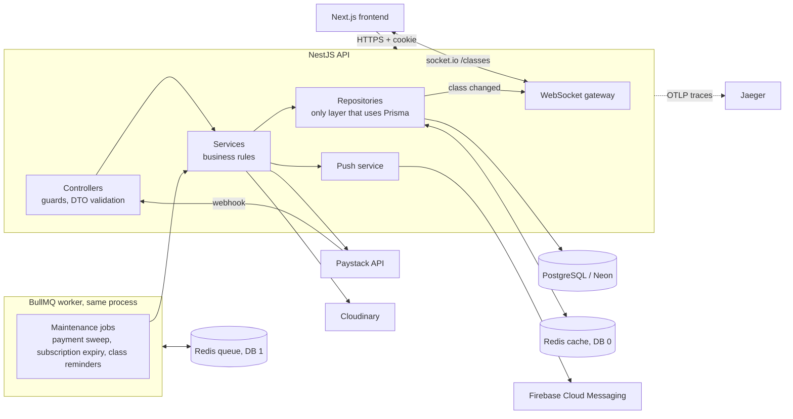

# Gym Ontime — Backend API

[](https://github.com/Dev-Jabbar/gym_ontime_nestjs_backend/actions/workflows/ci.yml)
[](https://github.com/Dev-Jabbar/gym_ontime_nestjs_backend/actions/workflows/integration.yml)

REST and WebSocket API for **Gym Ontime**, a gym class booking platform. Members browse classes and pay with Paystack to get a confirmed seat; trainers manage their classes; admins manage everything.

This is a full rebuild of an earlier Express + MongoDB backend onto **NestJS, Prisma and PostgreSQL**, adding Redis caching, BullMQ background jobs, live seat counts over WebSockets, Firebase push notifications, OpenTelemetry tracing, Docker and CI. It keeps the original `/api/...` paths, so the same Next.js frontend works against either backend (the frontend has a switch to pick Express + MongoDB or NestJS + PostgreSQL, and reads ids as `_id ?? id` so both response shapes work).

> **Project status:** feature-complete, **deployed and live**. The API runs on Render next to a Neon Postgres database, the frontend runs on Vercel, and payments work end to end in Paystack test mode. See [Live demo](#live-demo) and [Deployment](docs/DEPLOYMENT.md).

## Live demo

| What                           | URL                                             |
| ------------------------------ | ----------------------------------------------- |
| Frontend (Next.js on Vercel)   | https://gym-ontime.vercel.app                   |
| API documentation (Swagger UI) | https://gym-ontime-nest.onrender.com/api/docs   |
| API health check               | https://gym-ontime-nest.onrender.com/api/health |
| Frontend source                | https://github.com/Dev-Jabbar/Gym_Ontime        |

How to try it:

1. **The API sleeps when idle.** It runs on Render's free tier, which spins a service down after about 15 minutes without traffic. The first request can take up to a minute. Open the health URL first to wake it; it should answer `"status":"ok"`. In the frontend's backend picker the NestJS card shows an amber "waking up" dot while the service starts, and turns green when it is ready.
2. Open the frontend and, in the picker, choose **NestJS** (this API) or **Express** (the original MongoDB backend). The same screens work on both.
3. Register a new member account, pick a class and click **Book Now**.
4. Payments run in **Paystack test mode**, so no real money moves. Use the test card `4084 084 084 084 08`, any future expiry, CVV `408`, PIN `1234`, OTP `123456`.
5. After paying you return to the site, the class shows **Booked**, you get a "You're All Set!" notification, and anyone viewing the schedule sees the seat count change without refreshing.

Admin and trainer features need an account with that role, so they are not available to new visitors.

## Table of contents

- [Live demo](#live-demo)
- [Features](#features)
- [Architecture at a glance](#architecture-at-a-glance)
- [Tech stack](#tech-stack)
- [Getting started](#getting-started)
- [Documentation](#documentation)
- [Known limitations](#known-limitations)
- [Roadmap](#roadmap)
- [Contributing, security and license](#contributing-security-and-license)

## Features

- Cookie-based JWT authentication with role-based access (`member`, `trainer`, `admin`)
- Class management with capacity, pricing, recurrence and trainer assignment
- **Race-free seat booking** with 15-minute holds
- Paystack payments: one-time and subscription (weekly, monthly, three months)
- Payment reconciliation from three paths: the user's redirect, the Paystack webhook (verified over the raw request body) and a background sweep
- Subscriptions expire automatically and free the member's seat
- **Live seat counts**: every open browser sees capacity change without refreshing (socket.io)
- **Push notifications** (Firebase Cloud Messaging) and class reminders an hour before a session
- In-app notifications (payment confirmed, payment needs review, class reminders); admins are alerted too when a charged payment needs manual review
- Signed Cloudinary uploads (the file never passes through this server)
- Redis caching that **fails open** when Redis is unavailable
- **OpenTelemetry tracing** to Jaeger (optional)
- `GET /api/health` for load balancers and orchestrators
- Hardening: helmet, login/register rate limiting, environment-aware cookie, CORS from env, env validation at boot
- Admin seed script, soft deletes and a repository layer that isolates all database access

## Architecture at a glance



Controllers handle HTTP only, services hold the business rules, and repositories are the only code that touches Prisma. The seat-claim, payment-verification, caching and job designs are explained in [`docs/ARCHITECTURE.md`](docs/ARCHITECTURE.md), and the reasoning behind the main choices is recorded in [`docs/adr/`](docs/adr/README.md).

## Tech stack

| Concern    | Choice                                                                                |
| ---------- | ------------------------------------------------------------------------------------- |
| Framework  | NestJS 12                                                                             |
| Language   | TypeScript (ES modules)                                                               |
| Database   | PostgreSQL (Neon) via Prisma 7 with the `pg` driver adapter                           |
| Cache      | Redis via `ioredis`                                                                   |
| Queue      | BullMQ via `@nestjs/bullmq`                                                           |
| Real time  | socket.io via `@nestjs/websockets`                                                    |
| Push       | Firebase Admin SDK (FCM)                                                              |
| Tracing    | OpenTelemetry (OTLP) to Jaeger                                                        |
| Validation | `class-validator` / `class-transformer`, global `ValidationPipe({ whitelist: true })` |
| Auth       | JWT in an HTTP-only cookie, `bcrypt` (10 rounds)                                      |
| Security   | `helmet`, `@nestjs/throttler`                                                         |
| Payments   | Paystack (HTTP via `axios`)                                                           |
| Uploads    | Cloudinary (signed uploads)                                                           |
| Tests      | Vitest (102 unit tests + 13 tests against a real Postgres)                            |
| CI         | GitHub Actions                                                                        |
| Containers | Docker, Docker Compose                                                                |
| Lint       | oxlint                                                                                |

## Getting started

### Prerequisites

- Node.js 22 and npm
- A PostgreSQL database (a free [Neon](https://neon.tech) project works)
- Redis (optional; without `REDIS_URL` the cache and queue are skipped)
- A Paystack account (test keys are fine); Cloudinary and Firebase are optional

### Install and run

```bash
git clone https://github.com/Dev-Jabbar/gym_ontime_nestjs_backend.git
cd gym_ontime_nestjs_backend

npm install --legacy-peer-deps

cp .env.example .env          # fill in your own values (never commit .env)
npx prisma migrate deploy     # apply migrations
npx prisma generate

# optional: Redis and Jaeger in Docker
docker compose up -d redis jaeger

npm run start:dev             # http://localhost:3001/api
curl http://localhost:3001/api/health
```

Create the first admin account:

```bash
npm run seed:admin
```

### Scripts

| Command              | Purpose                            |
| -------------------- | ---------------------------------- |
| `npm run start:dev`  | Run with file watching             |
| `npm run build`      | Compile to `dist/`                 |
| `npm run start:prod` | Run the compiled build             |
| `npm run seed:admin` | Create or ensure the admin account |
| `npm run lint`       | Lint with oxlint                   |
| `npm test`           | Vitest (the real-Postgres tests are skipped unless `TEST_DATABASE_URL` is set) |

Environment variables are listed in [`docs/CONFIGURATION.md`](docs/CONFIGURATION.md) and in [`.env.example`](.env.example). The app validates them at boot and exits with a clear message if a required one is missing.

## Documentation

| Document | What it covers |
| --- | --- |
| [Architecture](docs/ARCHITECTURE.md) | System overview, data model, auth, payments flow, background jobs, caching, live seat counts, push |
| [Decision records](docs/adr/README.md) | Why the important choices were made (row locking, one payment routine, raw-body webhooks, fail-open cache, queues, id shapes, single instance, health probes) |
| [API reference](docs/API.md) | Every route and the role it needs. Interactive version: Swagger UI at `/api/docs` |
| [Configuration](docs/CONFIGURATION.md) | Every environment variable, with defaults |
| [Testing and CI](docs/TESTING.md) | Unit tests, real-Postgres tests, the two GitHub Actions workflows |
| [Deployment](docs/DEPLOYMENT.md) | Docker, Kubernetes, and the live Render + Neon + Vercel setup |
| [Operations](docs/OPERATIONS.md) | Health check, runbooks, tracing, troubleshooting |
| [Changelog](CHANGELOG.md) | What changed and when |

The Kubernetes manifests have their own guide in [`k8s/README.md`](k8s/README.md).

## Known limitations

These are documented rather than hidden:

- **Single instance only**: the WebSocket gateway, the in-memory rate limiter and the class-reminder job need shared pieces (the socket.io Redis adapter, a shared throttler store, a job lock) before running several replicas.
- The "Booked" label in the frontend is derived from payments, not membership, so a member removed by an admin still appears Booked.
- A `needsReview` payment returns `success: true` from `verify`, so the frontend shows a green success.
- `POST /payments/initiate` runs 20+ sequential database queries; it takes about 5 seconds from a distant region and far less next to the database.
- `PendingSeat` holds are not cleaned up when a member profile is deleted (they expire on their own).
- Class reminders use a fixed Africa/Lagos offset (UTC+1) and treat `monthly` recurrence as daily.
- Bulk replacement of a class's `members` through `PUT /classes/:id` (an Express feature) is not ported.
- The free Render instance sleeps when idle, so the first request after a quiet period is slow.

## Roadmap

Done: NestJS + Prisma + Postgres rebuild, Redis caching, BullMQ jobs, WebSocket live counts, Firebase push and reminders, OpenTelemetry tracing, production hardening, unit tests, Docker, CI with real-Postgres tests, Kubernetes manifests, admin alerts for payments that need review, and a live deployment (Render + Neon + Vercel) with Paystack test payments and Render auto-deploy from `master` once CI is green.

Next:

1. A full end-to-end booking test (register, login, pay, enroll) against a real database, with a Paystack stand-in
2. Swagger: add example responses to each route
3. Multi-instance support (socket.io Redis adapter, shared rate-limit store, reminder lock)

## Contributing, security and license

- Contributions and local workflow: [CONTRIBUTING.md](CONTRIBUTING.md)
- Reporting a vulnerability: [SECURITY.md](SECURITY.md) (please do not open a public issue)
- License: [MIT](LICENSE)
