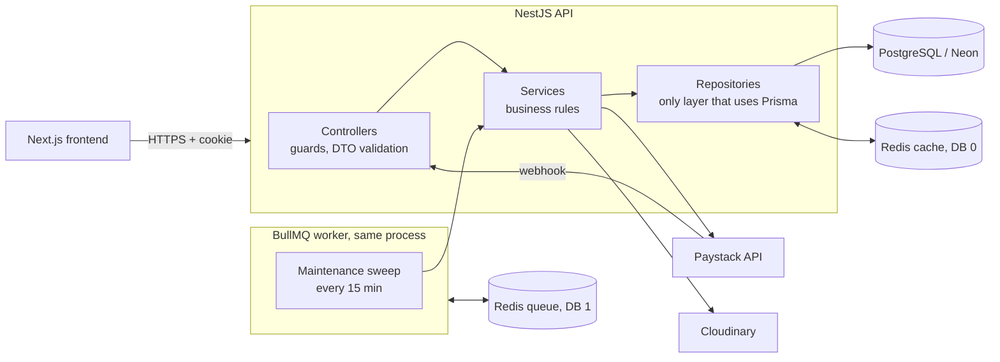
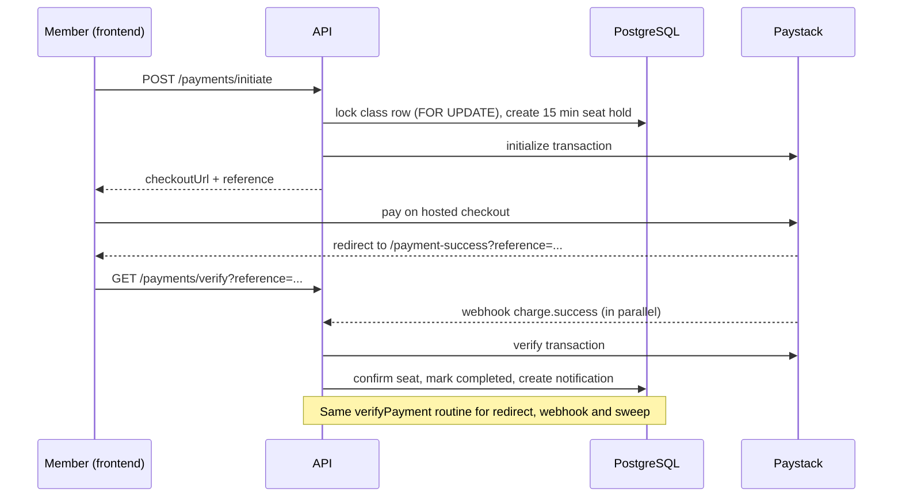

# Gym Ontime — Backend API

REST API for **Gym Ontime**, a gym class booking platform. Members browse classes and pay with Paystack to get a confirmed seat; trainers manage their classes; admins manage everything.

This is a full rebuild of an earlier Express + MongoDB backend onto **NestJS, Prisma and PostgreSQL**, with Redis caching and a BullMQ background job. It keeps the original `/api/...` paths and response shapes, so the existing Next.js frontend works against it unchanged.

> **Project status:** feature-complete for the core booking and payment flow and live-tested against a real Postgres (Neon) database. Subscription expiry, real-time seat updates, push notifications, observability and containerisation are in progress. See [Roadmap](#roadmap) and [Known limitations](#known-limitations).

## Table of contents

- [Features](#features)
- [Architecture](#architecture)
- [Tech stack](#tech-stack)
- [Data model](#data-model)
- [Key design decisions](#key-design-decisions)
- [Getting started](#getting-started)
- [Configuration](#configuration)
- [API reference](#api-reference)
- [Authentication and authorization](#authentication-and-authorization)
- [Payments flow](#payments-flow)
- [Background jobs](#background-jobs)
- [Caching](#caching)
- [Testing](#testing)
- [Deployment](#deployment)
- [Security](#security)
- [Troubleshooting](#troubleshooting)
- [Known limitations](#known-limitations)
- [Roadmap](#roadmap)

## Features

- Cookie-based JWT authentication with role-based access (`member`, `trainer`, `admin`)
- Class management with capacity, pricing, recurrence and trainer assignment
- **Race-free seat booking** with 15-minute holds
- Paystack payments: one-time and subscription (weekly, monthly, three months)
- Payment reconciliation from three paths: the user's redirect, the Paystack webhook and a background sweep
- In-app notifications (payment confirmed, payment needs review, and more)
- Signed Cloudinary uploads (the file never passes through this server)
- Redis caching that **fails open** when Redis is unavailable
- Admin seed script, soft deletes and a repository layer that isolates all database access

## Architecture



**Layering rules**

- Controllers handle HTTP concerns only (guards, DTOs, status codes).
- Services hold business rules and decide which HTTP exception an outcome maps to.
- Repositories are the only code that imports `PrismaService`. They return data, `null` or a result code, and never throw HTTP exceptions.
- Modules call each other through **services**, never through another module's repository.

## Tech stack

| Concern | Choice |
| --- | --- |
| Framework | NestJS 12 |
| Language | TypeScript |
| Database | PostgreSQL (Neon) via Prisma 7 with the `pg` driver adapter |
| Cache | Redis via `ioredis` |
| Queue | BullMQ via `@nestjs/bullmq` |
| Validation | `class-validator` / `class-transformer`, global `ValidationPipe({ whitelist: true })` |
| Auth | JWT in an HTTP-only cookie, `bcrypt` (10 rounds) |
| Payments | Paystack (HTTP via `axios`) |
| Uploads | Cloudinary (signed uploads) |
| Tests | Vitest (configured; see [Testing](#testing)) |
| Lint | oxlint |

## Data model

```mermaid
erDiagram
  User ||--o| MemberProfile : has
  User ||--o| TrainerProfile : has
  User ||--o| AdminProfile : has
  User ||--o{ Payment : makes
  User ||--o{ Notification : receives
  TrainerProfile ||--o{ Class : teaches
  Class ||--o{ ClassMember : "confirmed seats"
  MemberProfile ||--o{ ClassMember : enrolls
  Class ||--o{ PendingSeat : "15 min holds"
  MemberProfile ||--o{ PendingSeat : holds
  Class ||--o{ Payment : "paid for"
  Payment ||--o| ClassSubscription : creates
  Class ||--o{ ClassSubscription : covers
```

Notes: `ClassMember` has a unique `(classId, memberProfileId)` constraint so a member can't be enrolled twice. `PendingSeat` is a time-limited hold, and `ClassSubscription` stores `interval`, `startDate`, `endDate` and `status` (`active`, `expired`, `cancelled`). The schema lives in [`prisma/schema.prisma`](prisma/schema.prisma) and migrations in `prisma/migrations/`.

## Key design decisions

| Decision | Why |
| --- | --- |
| **`SELECT ... FOR UPDATE` inside a transaction for seat holds** | Guarantees two people can't take the last seat, without a denormalized counter that could drift. Seat correctness never depends on the cache. |
| **One `verifyPayment` routine for all payment outcomes** | The redirect, the webhook and the sweep all call it, so every path reaches the same state. It is idempotent. |
| **Cache-aside in repositories, fails open** | Redis is an optimisation, not a dependency. If it is down, requests are served from Postgres and errors are logged at most once every 30 seconds. |
| **Separate Redis DBs for cache and queue** | Queue data (DB 1, prefix `gymq`) can never collide with cache keys (DB 0). |
| **BullMQ repeatable job instead of an in-process cron** | Retries with backoff, a single worker at a time (`concurrency: 1`) and an admin endpoint to trigger a run. |
| **Signed Cloudinary uploads** | The API only signs a request. Image bytes go straight from the browser to Cloudinary. |
| **Response aliases (`_id`, `relatedClass`, ...)** | Kept so the existing frontend, written for MongoDB ids, works unchanged. |

## Getting started

### Prerequisites

- Node.js (LTS) and npm
- A PostgreSQL database (a free [Neon](https://neon.tech) project works)
- Redis (optional; without `REDIS_URL` the cache and queue are skipped)
- A Paystack account (test keys are fine) and a Cloudinary account

### Install and run

```bash
git clone https://github.com/Dev-Jabbar/gym_ontime_nestjs_backend.git
cd gym_ontime_nestjs_backend

npm install --legacy-peer-deps

cp .env.example .env          # fill in your own values (never commit .env)
npx prisma migrate deploy     # apply migrations
npx prisma generate

# optional: local Redis
docker run -d --name gym-redis -p 6379:6379 redis

npm run start:dev             # http://localhost:3001/api
```

Create the first admin account:

```bash
npm run seed:admin
```

### Scripts

| Command | Purpose |
| --- | --- |
| `npm run start:dev` | Run with file watching |
| `npm run build` | Compile to `dist/` |
| `npm run start:prod` | Run the compiled build |
| `npm run seed:admin` | Create or ensure the admin account |
| `npm run lint` | Lint with oxlint |
| `npm test` | Unit tests (Vitest) |
| `npm run test:e2e` | End-to-end tests (Vitest) |

## Configuration

Copy [`.env.example`](.env.example) to `.env`.

| Variable | Required | Default | Description |
| --- | --- | --- | --- |
| `DATABASE_URL` | Yes | | PostgreSQL connection string (use the pooled Neon URL) |
| `JWT_SECRET` | Yes | | Secret for signing session tokens; use a long random value |
| `FRONTEND_URL` | Yes | | Frontend origin; Paystack redirects to `${FRONTEND_URL}/payment-success` |
| `PAYSTACK_SECRET_KEY` | Yes | | Paystack secret key (`sk_test_...` in development) |
| `CLOUDINARY_CLOUD_NAME` | Yes | | Cloudinary cloud name |
| `CLOUDINARY_API_KEY` | Yes | | Cloudinary API key |
| `CLOUDINARY_API_SECRET` | Yes | | Cloudinary API secret |
| `REDIS_URL` | No | | Enables the cache and the queue. Use `rediss://` for TLS |
| `QUEUE_REDIS_DB` | No | `1` | Redis DB used by the queue |
| `MAINTENANCE_INTERVAL_MINUTES` | No | `15` | How often the sweep runs |
| `PAYMENT_STALE_MINUTES` | No | `30` | Age at which a pending payment is re-verified |
| `PORT` | No | `3001` | HTTP port |
| `NODE_ENV` | No | | `production` makes the admin seed require `ADMIN_PASSWORD` |
| `ADMIN_EMAIL`, `ADMIN_NAME`, `ADMIN_AVATAR`, `ADMIN_PASSWORD` | No | see seed | Admin seed settings; `ADMIN_PASSWORD` is **required** when `NODE_ENV=production` |

## API reference

Base URL: `/api`. Authentication uses the session cookie set at login. Payments endpoints respond with `{ success, message, data }`.

**Access:** *Public* = no login. *Auth* = any logged-in user. Otherwise the role(s) allowed.

| Area | Method and path | Access |
| --- | --- | --- |
| **Auth** (mounted under `/users`) | `POST /users/register` | Public |
| | `POST /users/login` | Public |
| | `GET /users/me` | Auth |
| | `POST /users/logout` | Public |
| **Users** | `GET /users` | admin |
| | `GET /users/:id`, `PUT /users/:id` | admin or the user themselves |
| | `DELETE /users/:id` (soft delete) | admin |
| | `POST /users/:id/upgrade-to-trainer` | admin |
| **Classes** | `GET /classes`, `GET /classes/:id`, `GET /classes/:id/member-count` | Public |
| | `POST /classes`, `PUT /classes/:id`, `DELETE /classes/:id` | admin |
| | `GET /classes/:id/members` | trainer, admin |
| | `GET /classes/by-member/:memberProfileId` | admin |
| | `POST` / `DELETE /classes/:id/members/:userId` | admin |
| | `PUT /classes/:id/trainer/:userId` | admin |
| **Members** | `POST /members/profile`, `GET` / `PUT` / `DELETE /members/me` | member |
| | `GET /members`, `GET /members/:id` | Public |
| **Trainers** | `POST /trainers/profile`, `GET` / `PUT` / `DELETE /trainers/me` | trainer |
| | `GET /trainers/my-classes` | trainer |
| | `GET /trainers`, `GET /trainers/:id` | Public |
| **Admin profile** | `GET /admins/me`, `PUT /admins/me` | admin |
| **Payments** | `POST /payments/initiate`, `GET /payments/verify`, `GET /payments/my-payments` | member |
| | `GET /payments`, `GET /payments/:id`, `GET /payments/class/:classId` | admin |
| | `POST /payments/webhook` | Public (verified by HMAC signature) |
| **Notifications** | `GET /notifications/my-notifications`, `PUT /notifications/:id/read`, `PUT /notifications/mark-all-read` | Auth |
| **Uploads** | `POST /uploads/signature` | Auth |
| **Maintenance** | `POST /maintenance/run` (queue a sweep now) | admin |

A Postman collection is used for manual testing. OpenAPI/Swagger documentation is on the [roadmap](#roadmap).

## Authentication and authorization

- Login sets an **HTTP-only** cookie containing a signed JWT. The browser cannot read it from JavaScript.
- `JwtAuthGuard` validates the cookie. `RolesGuard` with `@Roles(...)` enforces roles.
- "Admin or the user themselves" rules are checked inside the controller, since a role list can't express them.
- Passwords are hashed with bcrypt (10 rounds).

## Payments flow



- If Paystack reports the charge didn't succeed, the payment is marked `failed` and the seat hold is released.
- If the member was charged but the seat is no longer available, the payment is flagged `needsReview` and the member is notified.
- The background sweep re-verifies payments that stayed `pending`, so a closed browser tab doesn't lose a booking.

## Background jobs

A BullMQ repeatable job named `sweep` runs every 15 minutes (configurable):

1. Re-verifies pending payments older than `PAYMENT_STALE_MINUTES`.
2. Force-expires payments still unresolved after 24 hours.
3. Deletes expired seat holds.

It is idempotent, isolates each payment in its own try/catch, retries up to 3 times with exponential backoff, and logs a summary such as `{ checked, resolved, unresolved, hardExpired, holdsReleased }`. Admins can trigger a run with `POST /api/maintenance/run`.

If `REDIS_URL` is not set, the queue module is not loaded.

## Caching

- Class list and class detail reads are cached in Redis for 60 seconds (about 125x faster on a hit in testing).
- Seat reservation, payments and notifications **never** read the cache.
- Writes that change classes, trainers or members invalidate the affected keys after the transaction commits.
- If Redis is down, the API logs a throttled warning and serves from Postgres, then reconnects automatically.

## Testing

- The test runner is Vitest (`npm test`, `npm run test:e2e`).
- **Current state:** automated coverage is minimal (only the default spec exists). Behaviour has been verified manually against a live database, including the payment flow, seat holds, the maintenance job (abandoned payments, unverified paid payments, hold expiry, Redis outage and retry paths) and cache fail-open.
- Writing automated tests for the payment service, seat holds and the maintenance job is the top roadmap item.

## Deployment

There is no container image or deployment manifest yet (Docker is on the roadmap). Until then, a deployment needs:

1. Node.js and the build output: `npm ci --legacy-peer-deps && npm run build && npm run start:prod`.
2. PostgreSQL and (optionally) Redis, with `DATABASE_URL` and `REDIS_URL` set.
3. `npx prisma migrate deploy` on every release.
4. Production values for every required variable in [Configuration](#configuration): a long random `JWT_SECRET`, a Paystack **live** key, the real `FRONTEND_URL`, and `NODE_ENV=production`.
5. The Paystack dashboard webhook URL pointing at `POST /api/payments/webhook`.
6. A strong `ADMIN_PASSWORD` before running `npm run seed:admin`.

Before exposing it publicly, also address the items under [Known limitations](#known-limitations).

## Security

- Secrets come from environment variables only. `.env` is git-ignored, and GitHub secret scanning and push protection are enabled on this repository.
- Request bodies are validated and whitelisted by DTOs.
- Paystack webhooks are authenticated with an HMAC-SHA512 signature.
- Cloudinary uploads are signed server-side with a secret the browser never sees.
- Seat claims are serialized with row-level locks.

To report a vulnerability, please open a private security advisory on GitHub instead of a public issue.

## Troubleshooting

| Symptom | Cause and fix |
| --- | --- |
| `Can't reach database server` / `P1001` | Neon free tier is cold-starting or briefly unreachable. Retry. |
| `P1000` authentication error | Wrong database password in `DATABASE_URL`; copy the full connection string again. |
| `P2028` transaction errors after many restarts | A stale Node process holds connections. Kill it and restart. |
| New route returns 404 | A stale `start:dev` process. Restart it. `.env` changes also need a restart. |
| `Redis error (serving from Postgres)` warnings | Redis is down. Expected and harmless; the API keeps working. |
| `Request failed with status code 401` on `initiate` | Wrong `PAYSTACK_SECRET_KEY`. The seat hold is released automatically. |
| `npm install` peer-dependency errors | Use `npm install --legacy-peer-deps`. |

## Known limitations

These are documented rather than hidden:

- Subscriptions are not yet expired automatically (the expiry job is next on the roadmap).
- The webhook signature is computed over the re-serialized JSON body instead of the raw request bytes; it should use the raw body.
- Booking a class whose date has already passed is not rejected.
- Several list endpoints (`GET /members`, `GET /members/:id`, `GET /trainers`) are public to match the original API; they should be restricted or trimmed before production use.
- The session cookie is `sameSite: lax` and not marked `secure`; it needs to become environment-aware for a cross-domain deployment.
- No health endpoint, rate limiting or `helmet` yet.
- A `needsReview` payment currently returns `success: true` from `verify`.

## Roadmap

1. Subscription expiry job (hourly, in the existing queue)
2. Automated tests for payments, seat holds and the maintenance job, then CI
3. Production hardening: raw-body webhook signature check, health endpoint, `helmet`, rate limiting, env validation at boot, tightened public endpoints
4. OpenAPI / Swagger documentation
5. WebSocket gateway for live class capacity
6. Firebase push notifications and class reminders
7. OpenTelemetry tracing
8. Docker Compose and Kubernetes manifests

## License

Add a license of your choice (for example MIT) before others reuse this code.
