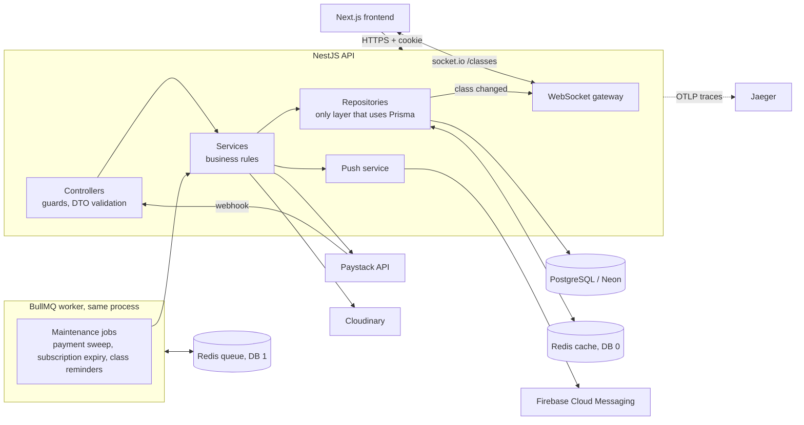
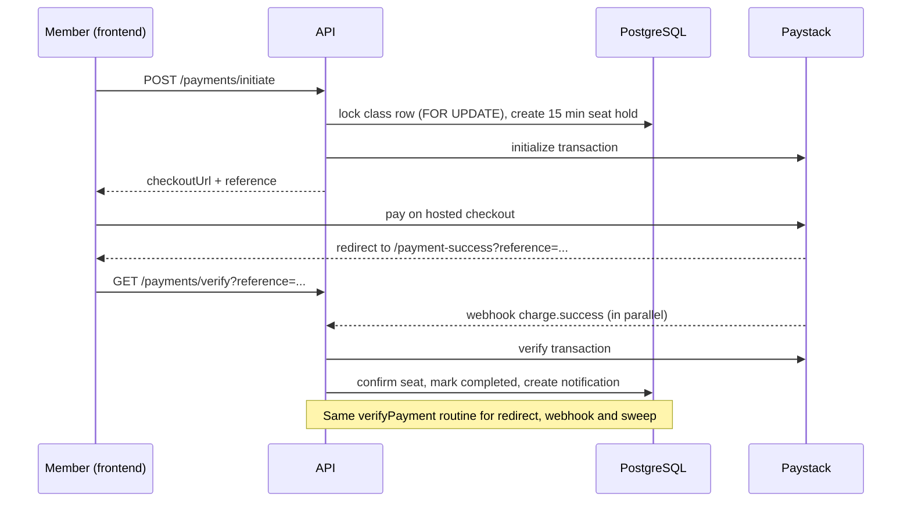

# Architecture

How the Gym Ontime backend is put together and why. For the one-page overview see the [README](../README.md); for the reasoning behind individual choices see the [decision records](adr/README.md).

## Contents

- [System overview](#system-overview)
- [Data model](#data-model)
- [Key design decisions](#key-design-decisions)
- [Authentication and authorization](#authentication-and-authorization)
- [Payments flow](#payments-flow)
- [Background jobs](#background-jobs)
- [Caching](#caching)
- [Live seat counts (WebSocket)](#live-seat-counts-websocket)
- [Push notifications](#push-notifications)

## System overview



**Layering rules**

- Controllers handle HTTP concerns only (guards, DTOs, status codes).
- Services hold business rules and decide which HTTP exception an outcome maps to.
- Repositories are the only code that imports `PrismaService`. They return data, `null` or a result code, and never throw HTTP exceptions.
- Modules call each other through **services**, never through another module's repository.

## Data model

```mermaid
erDiagram
  User ||--o| MemberProfile : has
  User ||--o| TrainerProfile : has
  User ||--o| AdminProfile : has
  User ||--o{ Payment : makes
  User ||--o{ Notification : receives
  User ||--o{ DeviceToken : "push devices"
  TrainerProfile ||--o{ Class : teaches
  Class ||--o{ ClassMember : "confirmed seats"
  MemberProfile ||--o{ ClassMember : enrolls
  Class ||--o{ PendingSeat : "15 min holds"
  MemberProfile ||--o{ PendingSeat : holds
  Class ||--o{ Payment : "paid for"
  Payment ||--o| ClassSubscription : creates
  Class ||--o{ ClassSubscription : covers
```

Notes: `ClassMember` has a unique `(classId, memberProfileId)` constraint so a member can't be enrolled twice. `PendingSeat` is a time-limited hold. `ClassSubscription` stores `interval`, `startDate`, `endDate` and `status` (`active`, `expired`, `cancelled`). `DeviceToken` stores one row per browser or device registered for push. The schema lives in [`prisma/schema.prisma`](../prisma/schema.prisma) and migrations in `prisma/migrations/`.

## Key design decisions

Each row is a summary. The decisions that shaped the system most have a full record (context, options, consequences) under [`docs/adr/`](adr/README.md).

| Decision                                                        | Why                                                                                                                                                                   |
| --------------------------------------------------------------- | --------------------------------------------------------------------------------------------------------------------------------------------------------------------- |
| **`SELECT ... FOR UPDATE` inside a transaction for seat holds** | Guarantees two people can't take the last seat, without a denormalized counter that could drift. Seat correctness never depends on the cache.                         |
| **One `verifyPayment` routine for all payment outcomes**        | The redirect, the webhook and the sweep all call it, so every path reaches the same state. It is idempotent.                                                          |
| **Webhook verified over the raw body with `timingSafeEqual`**   | Paystack signs the exact bytes it sends; re-serialising parsed JSON could reject a genuine event.                                                                     |
| **Cache-aside in repositories, fails open**                     | Redis is an optimisation, not a dependency. If it is down, requests are served from Postgres and errors are logged at most once every 30 seconds.                     |
| **Push and tracing fail open too**                              | Missing Firebase credentials or an unreachable Jaeger can never break a request or a payment.                                                                         |
| **Separate Redis DBs for cache and queue**                      | Queue data (DB 1, prefix `gymq`) can never collide with cache keys (DB 0).                                                                                            |
| **BullMQ repeatable jobs instead of in-process cron**           | Retries with backoff, one worker at a time (`concurrency: 1`) and admin endpoints to trigger a run.                                                                   |
| **Live counts read from Postgres, never the cache**             | The WebSocket broadcast always carries the true seat count.                                                                                                           |
| **Rate limiting only on login and register**                    | The brute-force targets are protected without throttling normal use.                                                                                                  |
| **Signed Cloudinary uploads**                                   | The API only signs a request. Image bytes go straight from the browser to Cloudinary.                                                                                 |
| **Frontend accepts both id shapes; a few response shims stay**  | The frontend reads `_id ?? id`, so Nest sends plain `id`. Only `relatedClass` / `relatedPayment` on notifications, `one-time` and numeric `amount` stay Mongo-shaped. |

## Authentication and authorization

- Login sets an **HTTP-only** cookie containing a signed JWT (7 days). The browser cannot read it from JavaScript.
- The cookie is environment-aware: `SameSite=Lax` locally; with `NODE_ENV=production` it is `SameSite=None; Secure`, which a frontend on another domain (such as Vercel) needs, and requires https.
- `JwtAuthGuard` validates the cookie, `OptionalJwtAuthGuard` identifies a user without requiring one, and `RolesGuard` with `@Roles(...)` enforces roles.
- "Admin or the user themselves" rules are checked inside the controller, since a role list can't express them.
- Passwords are hashed with bcrypt (10 rounds). Login and register are rate limited.

## Payments flow



- A one-off class that has already started cannot be booked (`400`). Recurring classes stay bookable.
- If Paystack reports the charge didn't succeed, the payment is marked `failed` and the seat hold is released.
- If the member was charged but the seat is no longer available, the payment is flagged `needsReview`, the member is notified, and every active admin gets a "Payment Needs Review" alert (in-app and push) naming the member, the class and the Paystack reference, so someone can refund or re-seat them.
- The background sweep re-verifies payments that stayed `pending`, so a closed browser tab doesn't lose a booking.
- The webhook checks the `x-paystack-signature` header (HMAC-SHA512 over the raw body, constant-time comparison) and returns `401` on a missing or wrong signature.

## Background jobs

Three BullMQ repeatable jobs run on the `maintenance` queue, one at a time, each with 3 attempts and exponential backoff.

### Payment sweep (every 15 minutes)

Re-verifies pending payments older than `PAYMENT_STALE_MINUTES`, force-expires payments still unresolved after 24 hours and deletes expired seat holds. Logs `{ checked, resolved, unresolved, hardExpired, holdsReleased }`. Trigger now: `POST /api/maintenance/run`.

### Subscription expiry (hourly)

Finds `active` subscriptions whose `endDate` has passed, removes the member from the class so the seat is freed, then marks the subscription `expired` so the member can subscribe again. The member is removed first and the status flipped last, so a failed step is retried on the next run. Logs `{ checked, expired, membersRemoved, failed }`. Trigger now: `POST /api/maintenance/expire-subscriptions`.

### Class reminders (every 15 minutes)

For each class whose session today starts within the next hour, notifies every enrolled member once per day (in-app and push). Weekday and start time are computed in Africa/Lagos time. Logs `{ checked, classesReminded, notified, failed }`. Trigger now: `POST /api/maintenance/class-reminders`.

All jobs are idempotent and isolate each item in its own try/catch. If `REDIS_URL` is not set, the queue module is not loaded.

## Caching

- Class list and class detail reads are cached in Redis for 60 seconds. Measured in Jaeger: about 2.0 s on a miss versus 4 to 13 ms on a hit.
- Seat reservation, payments, notifications and live counts **never** read the cache.
- Writes that change classes, trainers or members invalidate the affected keys after the transaction commits.
- If Redis is down, the API logs a throttled warning and serves from Postgres, then reconnects automatically.

## Live seat counts (WebSocket)

A socket.io gateway on the `/classes` namespace pushes seat changes to every connected browser.

- Server to client only: `class:capacity { classId, enrolled, capacity }` and `class:removed { classId }`. Nothing a client sends is acted on, and the numbers are the same ones public in `GET /classes`.
- Triggered when a payment is confirmed (redirect, webhook or sweep), an admin adds or removes a member, a subscription expires, or a class is created, updated or deleted.
- Changes are batched for 300 ms, and the count is read straight from Postgres.
- Single instance only for now; running more than one instance needs the socket.io Redis adapter.

## Push notifications

Firebase Cloud Messaging delivers a pop-up to the user's browser even when the site is closed (for example "You're All Set!" after payment, or a class reminder).

- A browser registers its token with `POST /api/notifications/device-token`. The token belongs to whoever was logged in when it was registered; logging out removes it.
- Sending is fire-and-forget after the in-app notification is saved, so a push can never slow down or break a payment. Dead tokens reported by FCM are deleted.
- Without the three `FIREBASE_*` variables, push is disabled and everything else works.
